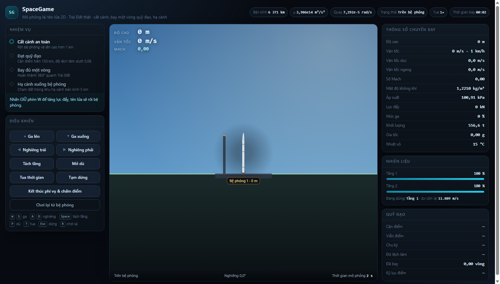

# SpaceGame — mô phỏng lái tên lửa 2D

Một phi vụ gồm ba pha trên cùng một màn hình: cất cánh khỏi bệ phóng, bay trọn một
vòng quỹ đạo quanh Trái Đất, rồi hạ cánh xuống khu hạ cánh của bệ phóng gần nhất.

Toàn bộ chuyển động được tính bằng công thức thật của Trái Đất: trọng lực Newton,
lực đẩy có hiệu chỉnh áp suất khí quyển, lực cản của khí quyển quay cùng Trái Đất
(nên hiệu ứng Coriolis xuất hiện tự nhiên), quán tính quay của thân tên lửa, gia
nhiệt khí động và các ngưỡng hư hỏng.



## Chạy game

Không cần cài gói nào, chỉ cần Node 20 trở lên (ES module không chạy được qua
`file://`, nên phải có một máy chủ tĩnh):

```powershell
npm start
```

Mở <http://localhost:8000>. Muốn đổi cổng: `PORT=3000 npm start`
(PowerShell: `$env:PORT=3000; npm start`).

Nếu không dùng npm: `node serve.mjs`, hoặc `python -m http.server 8000`.

## Điều khiển

| Phím | Tác dụng |
| --- | --- |
| `W` / `↑` | Tăng lực đẩy (giữ để tăng dần) |
| `S` / `↓` | Giảm lực đẩy |
| `A` / `←`, `D` / `→` | Nghiêng trái / phải |
| `Space` | Tách tầng |
| `P` | Bung dù hãm, rồi dù chính |
| `K` | Tạm dừng / chạy tiếp |
| `C` | Đổi giữa góc nhìn xa và góc nhìn gần |
| `F` | Bật/tắt lớp hiển thị lực |
| `Esc` | Thoát toàn màn hình (khi đang ở chế độ toàn màn hình) |
| `R` | Chơi lại từ bệ phóng |
| `E` | Kết thúc phi vụ và chấm điểm |
| `M` | Bật/tắt âm thanh |

Tua thời gian dùng **thanh trượt** trong panel “Điều khiển” (thang log 1× → 1000×), không có phím tắt.
Thanh giữ mức bạn đặt, còn chip **Tua** trên header hiện mức đang chạy thật — game tự hạ xuống khi
vào khí quyển hoặc khi động cơ đang cháy. Ngay dưới hai nút ga là **thanh mức ga** có vạch 25/50/75 %
và vạch vàng ở 40 % (dưới mức đó động cơ không cháy), nên nhìn là biết mình đang ga bao nhiêu.

Mọi thao tác đều có nút bấm tương ứng ở cột bên trái, và **mỗi nút in kèm phím tắt của nó**
dạng `Ga lên (W)`; dải gợi ý dưới các nút chỉ liệt kê những phím không có nút riêng (mũi tên,
`C`, `Esc`, `M`). Nút **toàn màn hình** nằm ở góc phải header: bấm một lần để cho cả trang chiếm
trọn màn hình, bấm lại (hoặc `Esc`) để thoát. Nút này được ẩn trên trình duyệt không hỗ trợ
Fullscreen API (ví dụ Safari trên iOS). Ngay cạnh đó là nút **góc nhìn** (hoặc phím `C`): **góc nhìn
xa** tự thu nhỏ để thấy cả Trái Đất, **góc nhìn gần** khoá tỉ lệ để luôn thấy rõ thân tên lửa, lửa
đẩy và mảnh tách tầng. Góc trái trên sân khấu xếp thành một cột trong suốt, đúng thứ tự: số đọc
(độ cao / vận tốc / Mach) → **danh sách lực** đang tác động (kèm số N) → **radar** với ba vòng
khoảng cách 100 km / 1 000 km / 10 000 km, bệ phóng gần nhất là blip cam đúng phương vị và khoảng
cách, vệt quỹ đạo đã bay vẽ thành đường radar, và ghi chú khu hạ cánh 5 km. Góc phải trên là
**trợ lý phi vụ** (xem mục dưới).

Bấm **Lớp lực** (hoặc `F`) để mở lớp “cảm biến lực”: một khung tên lửa nét đứt trùng với hình đang
bay, các vector lực thật của mô hình (lực đẩy, trọng lực, lực cản, lực nâng) với bảng chú giải ghi
số N hiện tại, và vector tổng hợp (gia tốc) vẽ phía trước mũi. Cụm mũi tên được dời sang một bên
tên lửa và nối với khung bằng một đường mảnh, nên hướng các lực không bị chồng lên thân: lực do tên
lửa sinh ra vẽ từ điểm neo hướng ra, lực bên ngoài vẽ từ ngoài chĩa vào điểm neo. Mỗi mũi tên dài
tối đa ~130 px và **ghi số ngay cạnh mũi tên** (`5,4 MN`, `317 kN`), nên đọc được cả hướng lẫn độ lớn
mà không phải liếc xuống bảng chú giải. Độ dài mũi tên tự co theo lực lớn nhất trong
khung hình, nên lực cản vài chục kN vẫn đọc được bên cạnh lực đẩy hàng nghìn kN.

Quanh Trái Đất có các **vòng nét đứt** ở những mốc độ cao có ý nghĩa: 100 km (danh giới vũ trụ
Kármán), 400 km (quỹ đạo trạm ISS), 2 000 km, 10 000 km và 35 786 km (quỹ đạo địa tĩnh GEO). Nhìn
vòng là biết mình đang ở đâu. Dòng **Trọng trường** trong panel Thông số chuyến bay hiện g đúng tại
bán kính đang bay (`g = μ/r²`): 9,82 m/s² trên bệ, còn khoảng 8,69 m/s² ở 400 km và chỉ 0,22 m/s² ở
quỹ đạo địa tĩnh — đó là lý do tên lửa càng lên cao càng "nhẹ".

## Cách bay một phi vụ trọn vẹn

1. **Cất cánh.** Giữ `W` tới 100 % ga. Tên lửa rời bệ khi lực đẩy vượt trọng lượng.
2. **Nghiêng dần.** Qua 1,5 km, bắt đầu nghiêng sang phải (`D`) để chuyển từ bay
   thẳng đứng sang bay ngang. Nghiêng quá sớm sẽ mất độ cao; nghiêng quá muộn sẽ
   tốn nhiên liệu. Đang cháy động cơ thì gimbal lo việc nghiêng; khi động cơ tắt,
   mỗi lần nghiêng tốn khí RCS (bình ~60 giây đốt) — hết khí thì chỉ còn cánh lái
   khí động, tức là phải có luồng khí mới xoay được.
3. **Tách tầng.** Khi tầng 1 cạn nhiên liệu (đèn báo nhấp nháy), nhấn `Space`.
   Tầng 1 rời ra thành một mảnh riêng: nó rơi theo trọng lực và lực cản, có thể
   bốc cháy khi lao vào khí quyển, chạm đất thì tóe bụi rồi biến mất.
4. **Chèn quỹ đạo.** Tầng 2 cháy tiếp cho tới khi cận điểm trên 150 km và độ lệch
   tâm dưới 0,08. Bảng "Quỹ đạo" hiện cận điểm, viễn điểm, chu kỳ và độ lệch tâm.
5. **Bay một vòng.** Kéo thanh **Tua thời gian** lên 100×–1000×; game tự hạ về 10× dưới 120 km
   và về 1× khi vào khí quyển — chip “Tua” trên header cho biết mức thật đang chạy.
6. **Hạ quỹ đạo.** Quay đuôi về phía trước (nghiêng ngược chiều bay) rồi cháy
   động cơ để hạ cận điểm xuống khoảng 30–40 km. Tư thế "đuôi dẫn đầu" giúp tấm
   chắn nhiệt ở đáy vỏ hứng dòng khí: lực cản tăng, gia nhiệt giảm.
7. **Vào lại khí quyển.** Giữ tư thế đó. Nếu nhiệt vỏ vượt 2 000 °C, tên lửa cháy.
8. **Giảm tốc và mở dù.** Có **hai tầng dù**: nhấn `P` dưới 20 km và dưới 250 m/s để
   bung **dù hãm** (giảm tốc từ từ), rồi nhấn `P` lần nữa dưới 8 km và dưới 120 m/s để
   bung **dù chính**. Không cần nhấn lần hai: dù chính **tự bung** khi đã có dù hãm và
   xuống dưới 4 km. Mở dù khi còn quá nhanh sẽ rách dù.
9. **Chạm đất.** Cả hai dù đưa tốc độ rơi về khoảng **11 m/s**; chỉ cần một nhịp cháy
   động cơ ngắn để chạm đất dưới 6 m/s và nghiêng dưới 12°. Hạ cánh trong khu hạ cánh 5 km quanh bệ là
   hoàn tất mục tiêu cuối.

## Trợ lý phi vụ (DeepSeek)

Trợ lý ở góc phải trên sân khấu: bật công tắc **Trợ lý**, đặt số giây giữa hai lần hỏi (2–60 giây,
mặc định 5). Mỗi nhịp, game gửi cho trợ lý một gói số liệu gọn của tàu — độ cao, tốc độ (dọc/ngang),
Mach, góc nghiêng, mức ga, lực đẩy, khối lượng, tải trọng, nhiệt vỏ, áp suất, tên tầng, phần trăm
nhiên liệu hai tầng và khí RCS, các phần tử quỹ đạo, bốn thành phần lực, bệ phóng gần nhất cùng
khoảng cách — và nhận lại **tối đa 2 câu tiếng Việt**: trạng thái hiện tại + một hành động cụ thể nên
làm.

Cách bật:

```powershell
Copy-Item .env.example .env      # rồi mở .env điền DEEPSEEK_API_KEY
npm start
```

`.env` đã nằm trong `.gitignore` nên key không bị commit. Trình duyệt **không** giữ key: nó gọi
`POST /api/assistant` của `serve.mjs`, server mới là nơi gắn `Authorization` và gọi DeepSeek
(`deepseek-chat`). Chưa có key hoặc mất mạng thì panel hiện đúng lỗi kèm nút **Thử lại**, phần còn
lại của game vẫn chạy bình thường.

## Kiểm chứng

```powershell
npm test          # chạy cả hai bộ kiểm chứng
npm run verify    # 101 phép kiểm tra số học từng công thức vật lý
npm run smoke     # một phi công tự động bay trọn phi vụ trong Node
```

`verify.mjs` kiểm tra khí quyển chuẩn, trọng lực, lực đẩy, Tsiolkovsky, lực cản,
bảo toàn năng lượng và mô men động lượng, quỹ đạo Kepler, gia nhiệt, tiếp đất,
nhiệm vụ và thang điểm — mọi giá trị đều được tính lại từ công thức gốc, kể cả gia tốc
trọng trường ở từng độ cao mà HUD và các vòng nét đứt dùng, và cảm biến lực (tổng lực chia
khối lượng phải bằng đúng gia tốc mà bộ tích phân dùng), và gói số liệu gửi trợ lý (đủ
trường, số đã làm tròn, dưới 2 KB). Từ giai đoạn
cải tiến, nó kiểm thêm mô men nghiêng bằng RCS (khí tiêu theo lưu lượng, khối lượng
giảm theo khí, gimbal khi cháy không tốn khí, hết khí thì mất điều khiển) và mảnh
tách tầng rơi (khối lượng khô, rơi về mặt đất, bị dọn khỏi mô phỏng).

`smoke-test.mjs` chạy đúng lõi vật lý mà trình duyệt dùng, thực hiện cất cánh, tách
tầng, chèn quỹ đạo, bay một vòng, hạ quỹ đạo, vào lại khí quyển, mở dù và tiếp đất,
rồi khẳng định trạng thái cuối cùng.

## Cấu trúc project

```
SpaceGame/
├─ index.html          bố cục màn hình game
├─ styles.css          giao diện buồng lái
├─ serve.mjs           máy chủ tĩnh + proxy /api/assistant tới DeepSeek
├─ .env.example        mẫu khai báo DEEPSEEK_API_KEY (chép thành .env)
├─ src/
│  ├─ constants.js     hằng số Trái Đất, thông số tên lửa, ngưỡng hư hỏng
│  ├─ atmosphere.js    ρ, p, nhiệt độ, vận tốc âm, Cd(Mach)
│  ├─ physics.js       RK4, trọng lực, lực đẩy, lực cản, mô men, gia nhiệt, tiếp đất
│  ├─ debris.js        mảnh tách tầng rơi: trọng lực, cản, gia nhiệt, chạm đất
│  ├─ rocket.js        hai tầng, nhiên liệu, dù, hư hỏng
│  ├─ world.js         Trái Đất và ba bệ phóng
│  ├─ mission.js       bốn mục tiêu và thang điểm
│  ├─ camera.js        zoom theo độ cao, tên lửa ở tâm
│  ├─ render.js        vẽ cảnh, tên lửa, hiệu ứng
│  ├─ hud.js           bảng thông số, cảnh báo, màn hình kết quả
│  ├─ input.js         bàn phím và nút bấm
│  ├─ endHold.js       giữ hiệu ứng nổ trước khi kết thúc phi vụ
│  ├─ assistant.js     gói số liệu gửi trợ lý + panel bật/tắt, nhịp giây
│  ├─ fullscreen.js    nút toàn màn hình, đồng bộ trạng thái qua fullscreenchange
│  ├─ audio.js         âm thanh WebAudio tổng hợp
│  └─ main.js          vòng lặp game
├─ verify.mjs          kiểm chứng từng công thức
├─ smoke-test.mjs      bay tự động đầu–cuối
├─ SPEC.md             đặc tả module (spec-graph)
└─ README.md
```

Lõi mô phỏng (`constants`, `atmosphere`, `rocket`, `world`, `physics`, `mission`)
là JavaScript thuần, không chạm DOM — nhờ vậy hai script kiểm chứng import được
chính đoạn mã mà trình duyệt chạy.

## Ghi chú về độ khó

Hạ cánh đúng khu hạ cánh sau một vòng quỹ đạo là bài toán dẫn đường thật: quỹ đạo
một vòng mất ~90 phút trong khi Trái Đất đã quay ~22°, nên điểm hạ cánh lệch khoảng
2 400 km so với bệ phóng. Người chơi cần chọn thời điểm hạ quỹ đạo và giữ tư thế
hợp lý trong suốt quá trình vào lại khí quyển.
